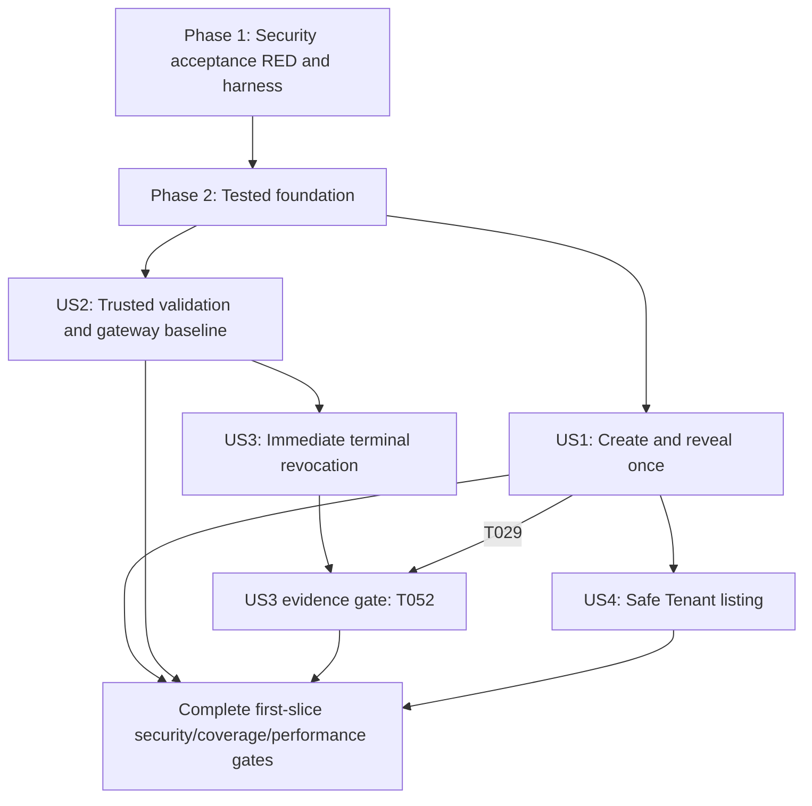

# Tasks: API Key Lifecycle — First Slice

**Input**: Design documents from `specs/001-api-key-lifecycle/`.
**Prerequisites**: [plan.md](plan.md), [spec.md](spec.md), [research.md](research.md),
[data-model.md](data-model.md), [contracts](contracts/), and constitution v1.2.0.
**Tests**: Mandatory. The user explicitly requires strict TDD and executable security
acceptance tests first for every feature. All task checkboxes below are intentionally open.
**Organization**: Setup -> shared foundation -> US1/US2/US3 (P1) -> US4 (P2) -> cross-cutting gates.
**Scope**: Task generation only. No source, test harness, package configuration, migration,
coverage result, or red/green execution evidence is produced by this command.

## Format: `[ID] [P?] [Story] Description`

- Every actionable item is `- [ ] T### [P?] [US#?] Description with exact file paths`.
- Story labels occur only in user-story phases. `[P]` means independent files after the
  stated prerequisite gate; it is never permission to implement before RED or edit shared files.
- RED, GREEN, and GATE are description prefixes, not extra checklist labels.
- Explicit dependency IDs are binding. Each task writes sanitized execution evidence later
  to `specs/001-api-key-lifecycle/evidence/T###.md` (its own ID); those files are not created now.

## Path Conventions

Single backend project: `src/`, `tests/`, `scripts/`, `build/`, and `coverage/` are repository-root
paths. Design/evidence paths are under `specs/001-api-key-lifecycle/`. `build/`, `coverage/`,
local SQLite/WAL files, and transient credential fixtures must not be committed as source.

## Mandatory TDD Execution Contract

The normative [request lifecycle contract](contracts/request-lifecycle.md) applies to every
phase: gateway 500 ms, authority validation 200 ms, shared identity 100 ms, management
2000 ms; absolute monotonic deadlines, cancellation with committed-state preservation,
and zero automatic retries/SQLite busy wait. These are design defaults, not measured passes.
Add the corresponding focused assertions and retain behavioral RED before implementing
each lifecycle behavior; a test added later cannot retroactively prove an earlier RED.
Keep the existing E-08/E-09/E-10/E-14 and rejection-path messages and 100% security coverage.

The literal first task writes executable security acceptance tests and includes only the
harness/runtime preparation necessary to run them. Never front-load production scaffolding
or domain behavior as an alleged setup prerequisite. Minimal callable unimplemented boundaries
may clear imports/compilation; they must not provide canned successful security outcomes.
Type-only declarations are test-enabling contracts, never behavioral RED evidence.

Every feature phase starts with security acceptance tests. Every GREEN task must first run
its phase security acceptance suite, then add/run the focused assertion for that change and
observe the intended behavioral failure before editing production logic. An unrelated earlier
feature failure, missing module, syntax/compiler error, or broken test configuration is not
that evidence. A negative secrecy assertion already satisfied remains a regression guard;
do not introduce an insecure behavior to manufacture a RED. A positive baseline must make
security assertions meaningful. Cases not reached because of an earlier missing behavior
are pending proof, not passed or credited as their own RED.

After the minimal implementation, the focused inner test and all already-implemented
regressions must be green before starting another production behavior. The broader outer
acceptance journey may remain RED only for explicitly documented, still-unimplemented tasks;
it must be fully green at its phase/story evidence gate. Do not suppress those pending cases
or credit their upstream failure as a later component's RED. Refactor only while the focused
and implemented-regression suites are green. Record command, intended assertion, observed
sanitized failure, passing result, and applicable coverage. New behavior found necessary in a GATE task follows the
same cycle. Verification-only tasks require no invented production change. Targeted TDD
runs are permitted; they never replace the final complete suites or authorize skipped tests.

For gateway invalidation, real active-key validation and two independently warmed real HTTP
gateway caches must work first. Revocation must then cause denial even when stale hints
remain and physical eviction is suppressed. No spy-only invalidation proof or always-denying
gateway is acceptable. A wrong active baseline is not a revocation-security RED.

Generated secrets, captured logs, bodies, digests, and credential values stay transient.
Assertions and evidence report sanitized booleans/codes, never matcher diffs or snapshots
that dump secret-bearing objects. Follow exact literal error messages in the OpenAPI contract.

The custom [security checklist](checklists/security.md) is reviewer-owned; consult its latest
review record and checkbox state for the requirements-quality gate before implementation.
Generating tasks does not check its items or waive review findings.
This task-generation command itself does not evaluate or modify that checklist.
## Phase 1: Setup (Security Acceptance Tests and Minimal Harness First)

**Goal**: Establish runnable security acceptance tests before any production behavior; harness preparation belongs in the opening test task.
### Tests and observed RED
- [X] T001 RED: Write and run the initial real-HTTP security journey in `tests/acceptance/security/first-slice.acceptance.test.ts`: create a Tenant-scoped key, keep its raw secret in memory, assert secret-free logs/events, then validate through two warmed gateways and revoke with no later acceptance. Within this same test task only, prepare the maintained Node24 >=24.15.0 <25 runtime and SQLite >=3.51.3 check, `.nvmrc`, `package.json`, `package-lock.json`, `tsconfig.json`, `tsconfig.test.json`, `jest.config.cjs`, `.gitignore`, `tests/support/acceptance-app.ts`, and minimal callable boundaries in `src/bootstrap/app.ts`; pin only typescript, jest, @jest/globals, and @types/node as dev dependencies. Declare every quickstart script and compile before Jest. Run `npm run test:acceptance:security -- --runInBand --runTestsByPath build/tests/acceptance/security/first-slice.acceptance.test.js`; the first intended RED is the missing successful scoped issuance assertion, not a loader/startup failure. Later warm-cache proof is still pending until US2/US3 supply its positive baseline; no secret-containing output may be retained.
- [X] T002 RED: Write runnable engineering-gate self-tests in `tests/contract/engineering-gates.test.ts` and isolated inventory fixtures in `tests/support/coverage-inventory-fixtures.ts`; require all-source coverage collection, explicit security-file branch thresholds of 100, rejection of omitted/unexecuted security files, clean build-before-test behavior, source/emitted inventory equality, and the selected runtime/storage capability checks. Run `npm run test:contract -- --runInBand --runTestsByPath build/tests/contract/engineering-gates.test.js`; record an assertion about absent gate behavior, never a missing npm script or package. Depends on T001.
### Implementation through RED -> GREEN
- [X] T003 GREEN: Implement the gate behavior specified by T002 in `jest.config.cjs`, `scripts/check-security-coverage.cjs`, `scripts/check-runtime.cjs`, `package.json`, and the TypeScript configs: CommonJS precompilation, transform disabled, V8 coverage over every emitted production file, no coverage-build source maps, exact security-file thresholds, and no ignored/skipped security branches. Self-test the inventory with fixtures; an empty or incomplete security inventory must not report product completion. Re-run the engineering-gate self-tests. The whole product security journey intentionally remains RED until its features exist. Depends on T002.
**Checkpoint**: Runnable harness and gate self-tests; the full feature security journey remains intentionally RED until its behavior is implemented.
---
## Phase 2: Foundational (Blocking Prerequisites)

**Goal**: Deliver tested domain contracts, existing identity integration seams, native crypto/storage, a shared decision gate, and secret-safe transport infrastructure.
**Blocking gate**: No user-story production implementation starts until the foundation gate passes.
### Tests and observed RED
- [X] T004 RED: Write and run `tests/acceptance/security/foundation.acceptance.test.ts` with explicit existing-identity fixtures in `tests/support/identity-fixtures.ts`, isolated temporary SQLite files, captured-in-memory logs, and minimal unimplemented public boundaries only. Specify E-01 before key lookup, verified Tenant selectors rather than trusted request claims, E-16 before validation key examination, service-identity outage denial, no credential logging, and refusal of normal bootstrap without a real injected verifier. Command: `npm run test:acceptance:security -- --runInBand --runTestsByPath build/tests/acceptance/security/foundation.acceptance.test.js`; record a missing security-guard assertion. Create compile-only subject boundaries needed by the next four independent RED tasks without implementing their behavior. Extend the opening security acceptance cases with request-lifecycle configuration defaults/invalid values, purpose-specific identity timeout denial, and premature-disconnect cancellation before any key operation. Keep unfinished story-specific commit/gateway cases explicitly pending. Depends on T003.
- [X] T005 [P] RED: Add security unit assertions in `tests/unit/authentication.test.ts` for invalid versus unavailable identities, same-Tenant developer authority, recognized untrusted service/developer validation callers, forged caller headers, trusted expected Tenant context, duplicate/missing/malformed scope, and fixture/normal composition separation. Run `npm run test:unit -- --runInBand --runTestsByPath build/tests/unit/authentication.test.js`; retain sanitized behavioral RED evidence. Using controlled monotonic time, require a shared 100 ms identity budget across successive calls, clamping to the request deadline, no reset/retry, cancellation propagation, and ignored late provider fulfillment/rejection without key examination or mutation. Depends on T004.
- [X] T006 [P] RED: Add unit assertions in `tests/unit/key-crypto.test.ts` for independent random prefix/secret/salt, canonical 52-character full keys, 8-character prefixes, fixed salt/digest lengths, SHA-256(salt bytes || UTF8(full key)), safe digest comparison, malformed material, entropy failures, and no plaintext diagnostics. Run `npm run test:unit -- --runInBand --runTestsByPath build/tests/unit/key-crypto.test.js`; report only sanitized booleans/codes in expected RED output. Depends on T004.
- [X] T007 [P] RED: Add native-SQLite security integration assertions in `tests/integration/storage-foundation.test.ts` and runtime domain-value assertions in `tests/unit/key-record.test.ts`: valid seed records, no raw-key column/value, immutable Tenant/terminal state, status/time consistency, preserved revoked records, non-unique prefixes, durable attempt outcomes, WAL/FULL readback, capability rejection, explicit fresh-store initialization versus refusal to recreate lost authoritative state, rollback/uncertainty classification, and no old read snapshot. Include actual SQLite behavior rather than fake repository verdicts. Run `npm run test:integration -- --runInBand --runTestsByPath build/tests/integration/storage-foundation.test.js`; a broken SQL script or unavailable native binding is not accepted RED evidence. Depends on T004.
- [X] T008 [P] RED: Add deterministic ordering/security unit assertions in `tests/unit/decision-gate.test.ts` for a shared total order of final decisions and transitions, release after failure, no asynchronous suspension in a final decision callback, and cancellation semantics. Run `npm run test:unit -- --runInBand --runTestsByPath build/tests/unit/decision-gate.test.js`; record the intended ordering assertion before implementing the primitive. Assert just-before and exactly-at deadline boundaries and that an expired/cancelled queued waiter never runs its callback, including when the timer callback has not fired. Depends on T004.
### Implementation through RED -> GREEN
- [X] T009 GREEN: Begin with `npm run test:acceptance:security -- --runInBand --runTestsByPath build/tests/acceptance/security/foundation.acceptance.test.js`; add/run the focused test `npm run test:unit -- --runInBand --runTestsByPath build/tests/unit/key-record.test.js` and retain its intended behavioral RED before the following production edit. Define the shared Key Record value guards/factories and safe public metadata contracts in `src/domain/key-record.ts` and `src/domain/key-metadata.ts`, preserving these data-model constraints verbatim: `keyId` (UUID string): "Stable random identifier; primary key; public metadata"; `tenantId` (Opaque platform Tenant identifier): "Required, verified at creation, immutable; public only in authorized context"; `prefix` (8 ASCII base64url characters): "First 8 characters of the full API Key; non-unique identification metadata"; `salt` (16-byte blob): "Independent cryptographically random per-key verification salt; internal only"; `keyHash` (32-byte blob): "SHA-256(salt bytes followed by UTF-8 full API Key); internal only"; `status` (active or revoked): "Initially active; only transition is active -> revoked"; `generation` (Positive integer): "Initially 1; becomes 2 on first revocation; unchanged by repeats"; `createdAt` (UTC timestamp): "Immutable creation time; metadata"; `revokedAt` (UTC timestamp or null): "Null exactly when active; first revocation time is immutable"; `creationAttemptId` (UUID string): "Correlates durable issuance and audit recovery; internal unique identifier"; `revocationAttemptId` (UUID string or null): "First effective revocation attempt; internal; unchanged by repeats". Add no expiration, deletion, mutable ownership, or recoverable raw-key field. Make the focused domain guard/factory assertions green here; database enforcement remains T013 and must retain its separate repository RED. Re-run both commands afterward; refactor only while green. Depends on T005, T006, T007, T008.
- [X] T010 GREEN: Begin with `npm run test:acceptance:security -- --runInBand --runTestsByPath build/tests/acceptance/security/foundation.acceptance.test.js`; add/run the focused test `npm run test:unit -- --runInBand --runTestsByPath build/tests/unit/security-attempt.test.js` and retain its intended behavioral RED before the following production edit. Define Security Attempt value guards/factories and verified identity/context contracts in `src/domain/security-attempt.ts` and `src/domain/identity.ts`, preserving the event constraints verbatim: `attemptId` (UUID): "Service-generated event correlation identity"; `operation` (create or revoke): "Recognized management operation"; `receivedAt` (UTC timestamp): "Receipt time; no raw URI/body stored"; `callerId` (Verified subject or null): "Null means identity is unknown, not a guessed token value"; `tenantId` (Verified/scoped ID or null): "Unknown is explicit"; `keyId` (Known stable ID or null): "Null for attempts before identity/record is known"; `outcome` (succeeded, rejected, failed, unconfirmed): "Actual business outcome, not response-delivery assumption"; `finalized` (Boolean): "False until terminal outcome/recovery is known"; `errorCode` (Safe E-code or transport code, or null): "No arbitrary exception text/stack/body"; `completedAt` (UTC timestamp or null): "Outcome completion time when known". Use explicit unknown/null identifiers and request-scoped verified principal kinds; never put tokens, arbitrary exception data, or raw keys in these records. Add focused redaction/unknown-outcome assertions in `tests/unit/security-attempt.test.ts` before adding any runtime behavior. Re-run both commands afterward; refactor only while green. Depends on T009.
- [X] T011 GREEN: Begin with `npm run test:acceptance:security -- --runInBand --runTestsByPath build/tests/acceptance/security/foundation.acceptance.test.js`; add/run the focused test `npm run test:unit -- --runInBand --runTestsByPath build/tests/unit/domain-errors.test.js` and retain its intended behavioral RED before the following production edit. Define framework-free boundaries in `src/ports/key-repository.ts`, `src/ports/identity-verifier.ts`, `src/ports/key-cryptography.ts`, `src/ports/security-event-repository.ts`, `src/ports/mutation-unit-of-work.ts`, `src/ports/clock.ts`, and safe typed errors in `src/domain/errors.ts`, following `specs/001-api-key-lifecycle/contracts/internal-boundaries.md`. Include global retained-prefix uniqueness candidates versus public Tenant-scoped reads, explicit committed/not-committed/uncertain outcomes, authentication versus dependency-unavailable outcomes, and sync final-decision callbacks. No HTTP/SQL objects may enter service contracts. Make focused safe-error code/projection assertions in `tests/unit/domain-errors.test.ts` green; type-only port declarations enable tests but do not substitute for behavioral RED. Prove dependency-direction rules separately in `tests/contract/layer-boundaries.test.ts`. Re-run both commands afterward; refactor only while green. Before adding deadline behavior, also write `tests/unit/request-context.test.ts`, run `npm run test:unit -- --runInBand --runTestsByPath build/tests/unit/request-context.test.js` and record its focused behavioral RED; then implement `src/domain/request-context.ts` with injected monotonic deadline/cancellation behavior and extend `src/ports/clock.ts` with monotonic time separate from UTC. Cover >= expiry, remaining-budget clamping, one-way cancellation, and no credential/HTTP retention; make both focused unit suites GREEN. Depends on T010.
- [X] T012 GREEN: Begin with `npm run test:acceptance:security -- --runInBand --runTestsByPath build/tests/acceptance/security/foundation.acceptance.test.js`; add/run the focused test `npm run test:unit -- --runInBand --runTestsByPath build/tests/unit/key-crypto.test.js` and retain its intended behavioral RED before the following production edit. Implement the tested crypto port in `src/adapters/crypto/node-key-crypto.ts` using Node built-ins only: 6 random prefix bytes, 32 independent random suffix bytes, 16 independent salt bytes, canonical base64url, and fixed-length digest comparison. Honor "Never trim or normalize a presented secret" and corrupt material -> unavailable/E-10, not acceptance or a secret-bearing exception. Re-run both commands afterward; refactor only while green. Depends on T011.
- [X] T013 GREEN: Begin with `npm run test:acceptance:security -- --runInBand --runTestsByPath build/tests/acceptance/security/foundation.acceptance.test.js`; add/run the focused test `npm run test:integration -- --runInBand --runTestsByPath build/tests/integration/storage-foundation.test.js` and retain its intended behavioral RED before the following production edit. Implement one native SQLite connection, schema, indexes, attempt persistence, and unit-of-work primitives in `src/adapters/sqlite/database.ts`, `src/adapters/sqlite/schema.ts`, `src/adapters/sqlite/security-events.ts`, and `src/adapters/sqlite/unit-of-work.ts`. Enforce all T009/T010 constraints, unique creationAttemptId, non-unique prefix index, scoped management lookup, bound parameters, WAL plus synchronous=FULL, SQLite >=3.51.3, and short transactions with no awaited network work. Provide an explicit fresh development/test store initializer; never infer that a missing previously authoritative file is a safe empty first run. Keep key creation/validation/revocation/listing repository operations for their story tasks. Re-run both commands afterward; refactor only while green. Configure zero SQLite busy wait and no implicit transaction retries. First extend the real storage assertions to verify lock contention returns the typed unavailable outcome and an entered synchronous mutation resolves committed/not-committed/uncertain without cancellation forcing rollback. Depends on T012.
- [X] T014 GREEN: Begin with `npm run test:acceptance:security -- --runInBand --runTestsByPath build/tests/acceptance/security/foundation.acceptance.test.js`; add/run the focused test `npm run test:unit -- --runInBand --runTestsByPath build/tests/unit/authentication.test.js` and retain its intended behavioral RED before the following production edit. Implement `src/services/authentication.ts` and `src/adapters/identity/host-identity.ts` as wrappers around a required host-supplied IdentityVerifier, not a new JWT/OAuth provider. Preserve "The HTTP envelope bounds length at 256 characters" for opaque Tenant selectors, missing/null/empty -> E-02, malformed/duplicate -> E-03, inaccessible/nonexistent -> E-04, service trust -> E-16, and purpose-specific unavailable outcomes. Never trust X-Tenant-ID, expectedTenantId, or caller-role headers without provider verification. Re-run both commands afterward; refactor only while green. Honor the shared identityTimeoutMs=100 budget and typed context from T011; pass remaining time/cancellation to the host, stop waiting at expiry, ignore late settlement, and perform zero automatic retries. Timeout is purpose-specific unavailability, never invalid credentials. Depends on T013.
- [X] T015 GREEN: Begin with `npm run test:acceptance:security -- --runInBand --runTestsByPath build/tests/acceptance/security/foundation.acceptance.test.js`; add/run the focused test `npm run test:unit -- --runInBand --runTestsByPath build/tests/unit/decision-gate.test.js` and retain its intended behavioral RED before the following production edit. Implement `src/services/decision-gate.ts` for the final synchronous fresh-status/decision and revocation commit boundary; exclude awaited external work and old read snapshots. A gate/authority failure denies rather than reuses a positive hint. Re-run the deterministic gate assertions from T008; gateway admission and concrete revocation integration remain story work. Re-run both commands afterward; refactor only while green. Use the typed context at gate entry and immediately before final decision/transaction entry; expired/cancelled queued work cannot execute. Read monotonic elapsed time even if a timer is delayed; do not interrupt an entered synchronous transaction solely for client cancellation. Depends on T014.
- [X] T016 GREEN: Begin with `npm run test:acceptance:security -- --runInBand --runTestsByPath build/tests/acceptance/security/foundation.acceptance.test.js`; add/run the focused test `npm run test:contract -- --runInBand --runTestsByPath build/tests/contract/transport-errors.test.js` and retain its intended behavioral RED before the following production edit. Implement secret-safe allowlisted logging in `src/adapters/logging/safe-logger.ts`, attempt/identity orchestration boundaries in `src/services/management-attempt.ts`, HTTP-only dispatch/error projection in `src/routes/api.ts`, and dependency injection in `src/bootstrap/app.ts`. Add focused assertions in `tests/contract/transport-errors.test.ts` first: literal E-01–E-16 mappings, transport-only codes from openapi.json, 8192-byte JSON safety limit, duplicate scope handling, no-store on all responses, and no raw headers/body/URI/stack serialization. Known unfinished feature handlers must remain honest unimplemented boundaries, never canned successful responses. Re-run both commands afterward; refactor only while green. Translate HTTP receipt/premature disconnect into the typed context and wire the monotonic clock only through composition. Extend focused transport tests before edits for existing 503 timeout mappings, no late 2xx, no response on disconnected sockets, and normal body completion not being cancellation. Leave commit-specific lifecycle proof to the story tasks. Depends on T015.
- [X] T017 GREEN: Begin with `npm run test:acceptance:security -- --runInBand --runTestsByPath build/tests/acceptance/security/foundation.acceptance.test.js`; add/run the focused test `npm run test:acceptance:security -- --runInBand --runTestsByPath build/tests/acceptance/security/foundation.acceptance.test.js` and retain its intended behavioral RED before the following production edit. Implement normal and explicit local/test composition in `src/bootstrap/main.ts` and `src/bootstrap/development.ts`; require a real injected identity verifier for normal composition, reject fixture fallback and non-loopback development binding, and report only safe readiness at GET /health/ready. Normal/recovery bootstrap must not silently recreate missing/corrupt authoritative state. Only explicit fresh-store initialization may create a new empty development/test database; an unsafe missing store or missing verifier means not ready/refuse bootstrap. Keep fixtures in `tests/support/identity-fixtures.ts` transient and out of logs; add the startup-negative assertions to the foundation acceptance suite before changing composition behavior. Re-run both commands afterward; refactor only while green. Validate the trusted composition settings gatewayValidationTimeoutMs=500, validationTimeoutMs=200, identityTimeoutMs=100, managementTimeoutMs=2000; require positive integers, identity <= validation < gateway and identity <= management, reject invalid configuration, and never accept deadline-extension headers. Depends on T016.
### Story or phase evidence gate
- [X] T018 GATE: Run the foundation acceptance, engineering/transport/layer contract, crypto/authentication/gate unit, and storage integration suites using their package commands; record sanitized results and current security coverage in `specs/001-api-key-lifecycle/evidence/foundation.md`. Confirm no production service imports concrete storage/HTTP adapters. Keep the unfinished full first-slice journey explicitly pending rather than hiding or skipping it. No user-story implementation may start with a harness/configuration failure or an unrecorded intended RED. Depends on T017.
**Checkpoint**: Shared security prerequisites pass targeted tests with truthful remaining-feature RED status.
---
## Phase 3: User Story 1 — Generate a Tenant-Scoped Key and Receive Its Secret Once (Priority: P1)

**Goal**: Issue one new active key for a verified Tenant and reveal its raw secret only in the committed creation response.
**Independent Test**: Using an existing developer identity and isolated real SQLite repository, create a key, inspect safe stored/public metadata and captured logs/events, and reject subsequent retrieval. Validation/revocation need not run in this story test.
**Opening security command**: `npm run test:acceptance:security -- --runInBand --runTestsByPath build/tests/acceptance/security/creation.acceptance.test.js`.
### Tests and observed RED
- [X] T019 [US1] RED: Write and run `tests/acceptance/security/creation.acceptance.test.ts` before issuance code: explicit authorized Tenant, 201 active metadata, prefix equals the first 8 secret characters, one-time secret delivery, E-01–E-04 rejection without issuance, E-08 on uncertainty, no plaintext in logs/events/storage, and no hash/salt in output. Add only callable unimplemented story boundaries for compilation; use the real app/repository and keep secrets transient. Required RED command: `npm run test:acceptance:security -- --runInBand --runTestsByPath build/tests/acceptance/security/creation.acceptance.test.js`; expected failure is missing successful secure issuance, not failure to start the app. Add controlled 2000 ms expiry/disconnect scenarios before mutation entry and after a real creation commit: E-08 if connected, no later secret delivery/replay, no second automatic creation, and safe retained metadata/events. Depends on T018.
- [X] T020 [P] [US1] RED: After the opening creation RED, add response/error contracts in separate `tests/contract/creation-contract.test.ts` and `tests/contract/secret-retrieval-contract.test.ts` files for createApiKey and rejectSecretRetrieval: exact statuses/messages, no-store, public field allowlists, unknown/foreign lookup indistinguishability, OPERATION_UNAVAILABLE on rejection-route dependency failure, and no later secret. Run `npm run test:contract -- --runInBand --runTestsByPath build/tests/contract/creation-contract.test.js` before those handlers. Depends on T019.
- [X] T021 [P] [US1] RED: Add `tests/integration/creation-persistence.test.ts` and `tests/unit/creation.test.ts` for retained-prefix historical matching across all Tenants including revoked records, same-prefix distinct secrets, 8-candidate retry exhaustion, random-source faults, transaction uncertainty, and no persisted unsalted fingerprint. Use valid seeded verifier records as the positive baseline; only a failure at the issuance/non-reuse assertion counts. Run the matching integration/unit commands before the repository and service changes. Include cancellation before transaction entry versus after actual commit, ignored late identity completion, exactly one mutation attempt, and secret-free uncertainty outcomes. Depends on T019.
- [X] T022 [US1] RED: Write `tests/acceptance/security/creation-events.acceptance.test.ts` for succeeded/rejected/failed/unconfirmed creation attempts, explicit unknown identities, durable record/outcome correlation, lost response without secret replay, and redacted emergency behavior during total storage loss. Run `npm run test:acceptance:security -- --runInBand --runTestsByPath build/tests/acceptance/security/creation-events.acceptance.test.js`; record the missing outcome behavior, not an unrelated earlier lookup failure. Depends on T020, T021.
### Implementation through RED -> GREEN
- [X] T023 [US1] GREEN: Begin with `npm run test:acceptance:security -- --runInBand --runTestsByPath build/tests/acceptance/security/creation.acceptance.test.js`; add/run the focused test `npm run test:unit -- --runInBand --runTestsByPath build/tests/unit/key-dtos.test.js` and retain its intended behavioral RED before the following production edit. Implement explicit creation/metadata projections in `src/domain/key-dtos.ts` so stored salt/hash/attempt fields cannot be spread into public responses; the raw API Key is returned only in the creation DTO. Cover output exclusions with focused cases in `tests/unit/key-dtos.test.ts`; preserve every public metadata constraint from T009. Re-run both commands afterward; refactor only while green. Depends on T022.
- [X] T024 [US1] GREEN: Begin with `npm run test:acceptance:security -- --runInBand --runTestsByPath build/tests/acceptance/security/creation.acceptance.test.js`; add/run the focused test `npm run test:integration -- --runInBand --runTestsByPath build/tests/integration/creation-persistence.test.js` and retain its intended behavioral RED before the following production edit. Implement issuance repository operations in `src/adapters/sqlite/creation-repository.ts`: serialize full retained-prefix candidate comparison and insertion, include revoked and other-Tenant records internally, compare using each stored salt, preserve immutable ownership, and link the attempt identity. Regenerate duplicate full secrets at most 8 times then E-08. No external fingerprint, raw-secret field, unique-prefix assumption, or HTTP-driven SQL. Re-run both commands afterward; refactor only while green. Depends on T023.
- [X] T025 [US1] GREEN: Begin with `npm run test:acceptance:security -- --runInBand --runTestsByPath build/tests/acceptance/security/creation.acceptance.test.js`; add/run the focused test `npm run test:unit -- --runInBand --runTestsByPath build/tests/unit/creation.test.js` and retain its intended behavioral RED before the following production edit. Implement `src/services/creation.ts` for verified Tenant scope, candidate generation, historical non-reuse, transaction result handling, and one-time DTO delivery after confirmed commit. Keep raw secrets only in request/issuance memory; map entropy/store/uncertainty failures to E-08. Creation retries are new attempts and never replay an old secret. Re-run both commands afterward; refactor only while green. Honor the management deadline/cancellation before transaction entry and response emission; once entered, resolve the real transaction safely. Never deliver/replay a secret after expiry/disconnect or automatically repeat creation. Depends on T024.
- [X] T026 [US1] GREEN: Begin with `npm run test:acceptance:security -- --runInBand --runTestsByPath build/tests/acceptance/security/creation.acceptance.test.js`; add/run the focused test `npm run test:integration -- --runInBand --runTestsByPath build/tests/integration/creation-attempts.test.js` and retain its intended behavioral RED before the following production edit. Use a direct service/real-repository integration test for this coordinator so unwired HTTP cannot mask its RED; wire creation attempt beginning before management processing and final outcome with the normal key transaction in `src/services/creation.ts` and `src/services/management-attempt.ts`; correlate interrupted attempts by creationAttemptId. Do not label a committed creation failed just because the response was lost or claim secret delivery without evidence. Keep fallback/emergency events allowlisted and readiness honest. Re-run both commands afterward; refactor only while green. Complete or recover truthful committed attempt outcomes independently of the expired/disconnected response context; cancellation must not relabel a known committed mutation as not committed or retain its raw secret. Depends on T025.
- [X] T027 [US1] GREEN: Begin with `npm run test:acceptance:security -- --runInBand --runTestsByPath build/tests/acceptance/security/creation.acceptance.test.js`; add/run the focused test `npm run test:contract -- --runInBand --runTestsByPath build/tests/contract/creation-contract.test.js` and retain its intended behavioral RED before the following production edit. Wire POST /v1/api-keys in `src/routes/api.ts` and `src/bootstrap/app.ts` to typed creation orchestration. Authenticate and verify explicit X-Tenant-ID before issuance; optional body is empty object only. Emit exact 201 CreatedKey and literal errors/no-store without raw-key request/response logging. Routes remain HTTP-only. Re-run both commands afterward; refactor only while green. Depends on T026.
- [X] T028 [US1] GREEN: Begin with `npm run test:acceptance:security -- --runInBand --runTestsByPath build/tests/acceptance/security/creation.acceptance.test.js`; add/run the focused test `npm run test:contract -- --runInBand --runTestsByPath build/tests/contract/secret-retrieval-contract.test.js` and retain its intended behavioral RED before the following production edit. Implement the deliberately rejecting GET /v1/api-keys/{keyId}/secret path through `src/services/secret-retrieval.ts` and `src/routes/api.ts`: verify developer/Tenant/scoped lookup, return E-11 for a known key, E-12 for unknown/foreign/invalid key IDs, and OPERATION_UNAVAILABLE/503 for identity or scoped-lookup outage. No retrieval/recovery capability or key mutation may exist. Re-run both commands afterward; refactor only while green. Depends on T027.
### Story or phase evidence gate
- [X] T029 [US1] GATE: Run the US1 security acceptance/events, contract, issuance unit/integration, and relevant current coverage gates. Record real red/green commands and sanitized outcomes in `specs/001-api-key-lifecycle/evidence/us1.md`; no secret-containing snapshots or evidence files. Prove US1 independently; the full first-slice journey still awaits validation/revocation. A creation-only demo is not the deployable agreed slice. Depends on T028.
**Checkpoint**: The story's independent security criteria and evidence gate pass; this does not waive other required stories or final whole-slice gates.
---
## Phase 4: User Story 2 — Validate a Key for Tenant Access (Priority: P1)

**Goal**: Admit only an active full key in trusted same-Tenant context, using authenticated trusted platform callers and a final authoritative decision.
**Independent Test**: Seed active/revoked and equal-prefix records for two Tenants, validate through authenticated service identity, and deny all invalid/unconfirmed/cross-Tenant cases without needing production key creation.
**Opening security command**: `npm run test:acceptance:security -- --runInBand --runTestsByPath build/tests/acceptance/security/validation.acceptance.test.js`.
### Tests and observed RED
- [X] T030 [US2] RED: Write and run `tests/acceptance/security/validation.acceptance.test.ts` with valid real SQLite seeds: trusted active same-Tenant success; no API Key echo/hash/salt; E-01 before key examination; E-16 for authenticated developers/untrusted callers; E-06 missing key; E-07 malformed/unknown/revoked/prefix-only/foreign key; E-10 unconfirmable context/state; no automatic expiration; no raw-key logging on any path. Command: `npm run test:acceptance:security -- --runInBand --runTestsByPath build/tests/acceptance/security/validation.acceptance.test.js` before validation implementation. Include exact 200 ms authority expiry, a shared 100 ms identity deadline, cancellation before D, and ignored late provider results. Assert E-10 and no positive decision/new key work after expiry, without automatic retries. Depends on T018.
- [X] T031 [P] [US2] RED: Add `tests/contract/validation-contract.test.ts` for the separate ServiceIdentity requirement, literal errors/statuses, untrusted expectedTenantId selector, UUID request binding, no-store, and safe ValidationDecision fields; do not permit an API Key as an alternative caller credential. Run `npm run test:contract -- --runInBand --runTestsByPath build/tests/contract/validation-contract.test.js` before the endpoint. Depends on T030.
- [X] T032 [P] [US2] RED: Add `tests/integration/validation-repository.test.ts` and `tests/unit/validation.test.ts`: evaluate all same-prefix candidates correctly, verify full-secret hashes and trusted owner, corrupt verifier lengths deny E-10, inactive/unknown deny E-07, and a final decision cannot use an old snapshot. Add identity outage and record-change-before-final-decision cases. Run focused integration/unit tests and retain intended RED evidence. Use controlled monotonic time for just-before and exactly-at identity/validation deadlines, gate wait expiration, and timer-callback delay; require the fresh final decision to recheck context validity. Depends on T030.
### Implementation through RED -> GREEN
- [X] T033 [US2] GREEN: Begin with `npm run test:acceptance:security -- --runInBand --runTestsByPath build/tests/acceptance/security/validation.acceptance.test.js`; add/run the focused test `npm run test:unit -- --runInBand --runTestsByPath build/tests/unit/validation-decision.test.js` and retain its intended behavioral RED before the following production edit. Define runtime-checked request-bound validation values in `src/domain/validation-decision.ts`: preserve "A validation request has a unique UUID `requestId` bound to one pending gateway operation" and "Only that original pending operation may consume it once" from the data model. Include service-generated decisionId, keyId, tenantId, and generation only; do not add a raw key, digest, salt, or reusable bearer capability. Re-run both commands afterward; refactor only while green. Depends on T031, T032.
- [X] T034 [US2] GREEN: Begin with `npm run test:acceptance:security -- --runInBand --runTestsByPath build/tests/acceptance/security/validation.acceptance.test.js`; add/run the focused test `npm run test:integration -- --runInBand --runTestsByPath build/tests/integration/validation-repository.test.js` and retain its intended behavioral RED before the following production edit. Implement prefix-candidate and fresh state lookup in `src/adapters/sqlite/validation-repository.ts`; never infer identity from prefix or reuse an earlier read transaction. Distinguish corrupt/unavailable verification material from a normal unmatched key. Keep concrete SQL behind the repository port. Re-run both commands afterward; refactor only while green. Depends on T033.
- [X] T035 [US2] GREEN: Begin with `npm run test:acceptance:security -- --runInBand --runTestsByPath build/tests/acceptance/security/validation.acceptance.test.js`; add/run the focused test `npm run test:unit -- --runInBand --runTestsByPath build/tests/unit/validation.test.js` and retain its intended behavioral RED before the following production edit. Implement `src/services/validation.ts` using existing authentication/trust/context verification, canonical full-key comparison, and the shared decision gate for the final fresh Tenant/status/generation read and finalized decision. Permit no async gap after that final check, no cached positive fallback, and no secret echo. Preserve E-01/E-16 before key examination and E-06/E-07/E-10 distinctions. Re-run both commands afterward; refactor only while green. Apply the 200 ms validation deadline and clamped shared identity budget; cancel/ignore outstanding provider work and check elapsed time immediately before D and success emission, returning E-10 rather than any expired positive result. Depends on T034.
- [X] T036 [US2] GREEN: Begin with `npm run test:acceptance:security -- --runInBand --runTestsByPath build/tests/acceptance/security/validation.acceptance.test.js`; add/run the focused test `npm run test:contract -- --runInBand --runTestsByPath build/tests/contract/validation-contract.test.js` and retain its intended behavioral RED before the following production edit. Wire POST /v1/api-keys/validations in `src/routes/api.ts` and `src/bootstrap/app.ts` to the validation service. Keep the existing service bearer separate from the transient body key, verify expectedTenantId with the host adapter, and return only the bound decision plus no-store. Do not build or assume an identity-provider endpoint. Re-run both commands afterward; refactor only while green. Depends on T035.
### Tests and observed RED
- [X] T037 [US2] RED: Now that the real authority validation path succeeds, write and run `tests/acceptance/security/gateway-admission.acceptance.test.ts` with two independent real HTTP gateway fixtures in `tests/support/gateway-servers.ts`. Require valid direct authority success first, then fresh online calls per operation, populated advisory cache entries without raw material, matching one-use requestId/decisionId, and denial on replay, timeout, cancellation, malformed response, or partition despite warm hints. Command: `npm run test:acceptance:security -- --runInBand --runTestsByPath build/tests/acceptance/security/gateway-admission.acceptance.test.js`; a broken authority baseline is not valid gateway RED. Extend GW-07 with the 500 ms outbound deadline (including connection/complete response), earlier platform cancellation, exact >= boundary, one outbound attempt, and disposal of late pre-R positives. Also prove the real authority denies at 200 ms and shares 100 ms across verifier calls; use deterministic clocks/boundaries, not sleep-based timing claims. Depends on T036.
### Implementation through RED -> GREEN
- [X] T038 [US2] GREEN: Begin with `npm run test:acceptance:security -- --runInBand --runTestsByPath build/tests/acceptance/security/validation.acceptance.test.js`; add/run the focused test `npm run test:acceptance:security -- --runInBand --runTestsByPath build/tests/acceptance/security/gateway-admission.acceptance.test.js` and retain its intended behavioral RED before the following production edit. Implement `src/gateway/enforcement.ts` for the online, request-bound, consume-once decision contract and metadata-only advisory cache. Enforce "They contain no raw key, digest, verification salt, reusable access token, or positive bearer verdict" and "Future operations always require a new decision" from the data model. Never authorize from local generation/hints; discard late responses for cancelled/timed-out requests. Keep platform business endpoint implementation out of scope. Re-run both commands afterward; refactor only while green. Enforce gatewayValidationTimeoutMs=500 or an earlier operation deadline, abort where supported, discard late settlement including pre-R positives after expiry, and clear listeners/secret references. No SDK/transport retry or old requestId resurrection; an explicit new operation needs a fresh requestId. Depends on T037.
### Story or phase evidence gate
- [X] T039 [US2] GATE: Run US2 validation/gateway security acceptance, contract, repository/unit, and current authentication/validation coverage gates. Record sanitized results in `specs/001-api-key-lifecycle/evidence/us2.md`. Prove seeded-record independence from creation; prove both gateways accept active keys and have populated advisory caches before authorizing US3 cache-invalidation work. Retain a genuine pending revocation RED in the whole-slice journey. Depends on T038.
**Checkpoint**: The story's independent security criteria and evidence gate pass; this does not waive other required stories or final whole-slice gates.
---
## Phase 5: User Story 3 — Revoke a Compromised Key Immediately (Priority: P1)

**Goal**: Make same-Tenant revocation durable and terminal before success, with no stale accepting decisions across gateways or restart.
**Independent Test**: Use seeded keys, two same-Tenant developers, and the real US2 validation/gateway baseline. Revoke as the non-creator, verify immediate denial through both gateways, repeat safely, and prove foreign-Tenant denial and restart persistence without requiring production creation/listing.
**Opening security command**: `npm run test:acceptance:security -- --runInBand --runTestsByPath build/tests/acceptance/security/revocation.acceptance.test.js`.
### Tests and observed RED
- [X] T040 [US3] RED: Write and run `tests/acceptance/security/revocation.acceptance.test.ts` before revoke code: first show an active key accepted through both real gateways and both caches populated, then revoke as a same-Tenant non-creator and require 200 only after effective enforcement plus E-07 for every later admission. Include secret-free success/failure logs/events. Command: `npm run test:acceptance:security -- --runInBand --runTestsByPath build/tests/acceptance/security/revocation.acceptance.test.js`; only the intended absent revocation/enforcement assertion after the active baseline counts as RED. Add GW-11 management lifecycle assertions at the 2000 ms boundary and premature disconnect, before transaction entry and after a real durable revoke commit: no late queued mutation, E-09 if writable, no late 2xx, preserved revoked state and original metadata, and no automatic retry. Depends on T039.
- [X] T041 [P] [US3] RED: Add separate `tests/contract/revocation-contract.test.ts` and `tests/contract/reactivation-contract.test.ts` files before their handlers. Keep first/repeated/concurrent revocation 200 with original timestamp, E-01–E-05/E-09/E-12 failures, and unknown/foreign indistinguishability in the revocation suite. Keep defensive reactivation E-13/E-15, authentication/Tenant failures, unknown/foreign E-12, OPERATION_UNAVAILABLE on rejection-route dependency outage, and no state mutation in the reactivation suite. Both suites assert no-store and no secret/hash/salt. Run `npm run test:contract -- --runInBand --runTestsByPath build/tests/contract/revocation-contract.test.js` and `npm run test:contract -- --runInBand --runTestsByPath build/tests/contract/reactivation-contract.test.js` separately and retain each intended behavioral RED. T048 makes only the revocation suite GREEN; the reactivation suite remains explicitly pending until T049 and is not part of T048's focused suite. Depends on T040.
- [X] T042 [P] [US3] RED: Add `tests/unit/revocation.test.ts` and `tests/integration/revocation-repository.test.ts` for active -> revoked only, preserved Tenant/time/generation/first attempt, same-Tenant non-creator authority, concurrent/idempotent outcomes, failure/uncertain commits, and safe audit finalization. Seed valid records so malformed data or absent creation cannot masquerade as revocation RED; run focused unit/integration commands. Cover safe resolution of an entered real transaction despite cancellation, commit-before-timeout-response races, preserved mutation/audit truth, and expiry preventing a not-yet-entered transaction. Depends on T040.
- [X] T043 [P] [US3] RED: Add `tests/integration/revocation-ordering.test.ts` for GW-03–GW-07 and GW-09: retain stale active hints deliberately, isolate one gateway, pause a decision before its final authority gate while revocation commits, handle an earlier finalized decision delivered late only for its original pending operation, and reject reuse/cancellation. Use deterministic scheduling around real production boundaries, not mocked successful invalidation or canned verdicts. Run `npm run test:integration -- --runInBand --runTestsByPath build/tests/integration/revocation-ordering.test.js` and record the intended security assertion. Include GW-11 and deterministic expiry/cancellation on both sides of real transaction entry/commit; never await inside the transaction or replace the production SQLite outcome with a canned verdict. Depends on T040.
- [X] T044 [US3] RED: Write `tests/acceptance/security/revocation-recovery.acceptance.test.ts` for GW-08: crash after confirmed revoke, after commit before response, unfinished audit attempt recovery, missing/corrupt state, and old-backup refusal. Assert revoked access is never restored, retries preserve original metadata, identity/audit/storage outages produce truthful E-09/E-10 and redacted events, and readiness stays false when recovery is unsafe. Run the focused acceptance command before recovery work. Depends on T041, T042, T043.
### Implementation through RED -> GREEN
- [X] T045 [US3] GREEN: Begin with `npm run test:acceptance:security -- --runInBand --runTestsByPath build/tests/acceptance/security/revocation.acceptance.test.js`; add/run the focused test `npm run test:integration -- --runInBand --runTestsByPath build/tests/integration/revocation-repository.test.js` and retain its intended behavioral RED before the following production edit. Implement `src/adapters/sqlite/revocation-repository.ts` with bound scoped lookup and a short durable terminal transition. Preserve "Initially 1; becomes 2 on first revocation; unchanged by repeats", "Null exactly when active; first revocation time is immutable", and "First effective revocation attempt; internal; unchanged by repeats". Record status/time/generation/first attempt atomically; distinguish no commit from uncertain commit and never reactivate or delete retained records. Re-run both commands afterward; refactor only while green. Resolve an entered transaction safely despite cancellation; use zero lock busy wait/no transaction retry and retain the real committed/not-committed/uncertain result. Depends on T044.
- [X] T046 [US3] GREEN: Begin with `npm run test:acceptance:security -- --runInBand --runTestsByPath build/tests/acceptance/security/revocation.acceptance.test.js`; add/run the focused test `npm run test:unit -- --runInBand --runTestsByPath build/tests/unit/revocation-transition.test.js` and retain its intended behavioral RED before the following production edit. Implement `src/services/revocation.ts` using verified same-Tenant authority and the shared gate with validation. The durable commit is R; any finalized decision D after R must reject. Preserve original timestamp/generation on repeat, deny foreign lookup, and acknowledge success only after enforcement is effective. No external notification delivery or cache TTL may create a grace period. Re-run both commands afterward; refactor only while green. Check the 2000 ms management context before gate callback/transaction entry and before success emission. Expiry/disconnect after R never restores active state; return E-09 if connected and leave durable outcome/audit finalization truthful. Depends on T045.
- [X] T047 [US3] GREEN: Begin with `npm run test:acceptance:security -- --runInBand --runTestsByPath build/tests/acceptance/security/revocation.acceptance.test.js`; add/run the focused test `npm run test:integration -- --runInBand --runTestsByPath build/tests/integration/revocation-attempts.test.js` and retain its intended behavioral RED before the following production edit. Use direct service/real-repository coordinator assertions before HTTP wiring; integrate received revoke-attempt/outcome recording in `src/services/revocation.ts`, `src/services/management-attempt.ts`, and `src/adapters/sqlite/security-events.ts`; persist known/unknown identities safely and reconcile uncertain finalization using revocationAttemptId. Never undo an effective revoke to repair audit or reply failure; do not claim durable logging during total media loss. Keep pending outcomes truthful and return E-09 rather than false success when completion cannot be confirmed. Re-run both commands afterward; refactor only while green. Finalize/reconcile known commit outcomes independently of response cancellation, without replaying the mutation. Cover cancellation cleanup and unavailable audit storage using focused real-repository assertions before changing coordination behavior. Depends on T046.
- [X] T048 [US3] GREEN: Begin with `npm run test:acceptance:security -- --runInBand --runTestsByPath build/tests/acceptance/security/revocation.acceptance.test.js`; add/run the focused test `npm run test:contract -- --runInBand --runTestsByPath build/tests/contract/revocation-contract.test.js` and retain its intended behavioral RED before the following production edit. Wire POST /v1/api-keys/revocations in `src/routes/api.ts` and `src/bootstrap/app.ts`; parse stable keyId, preserve explicit Tenant scope/identity precedence, map missing ID to E-05 and nonempty invalid/unknown/foreign ID to E-12, and return exact no-store RevokedKey responses. Keep authorization/lifecycle/SQL logic in services and adapters. Re-run both commands afterward; refactor only while green. Depends on T047.
- [X] T049 [US3] GREEN: Begin with `npm run test:acceptance:security -- --runInBand --runTestsByPath build/tests/acceptance/security/revocation.acceptance.test.js`; add/run the focused test `npm run test:contract -- --runInBand --runTestsByPath build/tests/contract/reactivation-contract.test.js` and retain its intended behavioral RED before the following production edit. Implement rejection-only POST /v1/api-keys/{keyId}/reactivate through `src/services/reactivation-rejection.ts` and `src/routes/api.ts`: authorized known revoked -> E-13, known active -> E-15, unknown/foreign -> E-12, dependency outage -> OPERATION_UNAVAILABLE. There is no active-restoration operation or state mutation. Re-run both commands afterward; refactor only while green. Depends on T048.
- [X] T050 [US3] GREEN: Begin with `npm run test:acceptance:security -- --runInBand --runTestsByPath build/tests/acceptance/security/revocation.acceptance.test.js`; add/run the focused test `npm run test:acceptance:security -- --runInBand --runTestsByPath build/tests/acceptance/security/revocation-recovery.acceptance.test.js` and retain its intended behavioral RED before the following production edit. Implement revocation-preserving recovery in `src/adapters/sqlite/recovery.ts` and `src/bootstrap/main.ts`: recover the authoritative file/WAL and interrupted attempt outcomes before readiness, start advisory caches empty, never synthesize active status, and refuse unsafe old/corrupt/missing state. Preserve committed revoked records after process restart or lost reply; do not create backup restoration automation or an availability SLA. Re-run both commands afterward; refactor only while green. Depends on T049.
### Story or phase evidence gate
- [X] T051 [US3] GATE: Run real two-gateway acceptance and `tests/integration/revocation-ordering.test.ts` for GW-01–GW-09; assert active warm baselines, no post-R accepting decisions even with physical eviction suppressed, partition denial, and bound delayed-response semantics. Persist sanitized ordering/evidence in `specs/001-api-key-lifecycle/evidence/gateway-ordering.md`. If a new production correction is needed in validation/revocation/enforcement, first retain its focused behavioral RED; otherwise make no artificial code change. Also run GW-11 and require controlled evidence of cancelled waiters, ignored late positives, one attempt, and durable revocation surviving timeout/disconnect across both gateways. Depends on T050.
- [X] T052 [US3] GATE: Run US3 acceptance/contract/unit/integration/recovery suites, the initial first-slice security journey, and `npm run test:coverage` with all currently implemented authentication/revocation files included. Require real 100% branch reports and zero secret-bearing evidence before recording `specs/001-api-key-lifecycle/evidence/us3.md`; add missing failure assertions before corrective behavior. Listing remains required before final feature completion. Depends on T051 and T029.
**Checkpoint**: The story's independent security criteria and evidence gate pass; this does not waive other required stories or final whole-slice gates.
---
## Phase 6: User Story 4 — List Non-Secret Key Metadata Within a Tenant (Priority: P2)

**Goal**: Return the complete same-Tenant active/revoked collection with safe identifying metadata and no secret disclosure.
**Independent Test**: Seed active/revoked records with equal prefixes for two Tenants; list as either authorized same-Tenant developer, assess complete safe metadata and empty/error outcomes, and reject foreign/untrusted requests without invoking creation or revocation.
**Opening security command**: `npm run test:acceptance:security -- --runInBand --runTestsByPath build/tests/acceptance/security/listing.acceptance.test.js`.
### Tests and observed RED
- [X] T053 [US4] RED: Write and run `tests/acceptance/security/listing.acceptance.test.ts` before listing code: all same-Tenant active/revoked keys including colleagues' records, correct required metadata, no raw keys/digests/salts in responses/logs, no cross-Tenant records, and denied unauthenticated/unauthorized scope. Use real valid seeds and in-memory raw-secret sentinels. Command: `npm run test:acceptance:security -- --runInBand --runTestsByPath build/tests/acceptance/security/listing.acceptance.test.js`; expected RED is missing complete safe listing, not seed/harness failure. Include controlled 2000 ms expiry/disconnect and late identity/repository results: E-14 if connected, no partial/late successful collection, and zero automatic retry. Depends on T018, T029.
- [X] T054 [P] [US4] RED: Add `tests/contract/listing-contract.test.ts` for exact complete KeyCollection/empty success, metadata allowlists, no-store, E-01–E-04 and E-14, no success for partial/failed listing, and no pagination/truncation or secret/hash/salt fields. Run the focused contract command before the handler. Depends on T053.
- [X] T055 [P] [US4] RED: Add `tests/integration/listing-repository.test.ts` and `tests/unit/listing.test.ts` for Tenant filtering across both lifecycle states, duplicate prefixes distinguished by stable IDs, complete collection delivery, safe metadata projection, repository errors, and no new listing audit stream. Run focused integration/unit commands and record the intended missing listing/projection assertion. Add listing request-context expiry/cancellation and no-late-result cases before implementing those paths. Depends on T053.
### Implementation through RED -> GREEN
- [X] T056 [US4] GREEN: Begin with `npm run test:acceptance:security -- --runInBand --runTestsByPath build/tests/acceptance/security/listing.acceptance.test.js`; add/run the focused test `npm run test:integration -- --runInBand --runTestsByPath build/tests/integration/listing-repository.test.js` and retain its intended behavioral RED before the following production edit. Implement `src/adapters/sqlite/listing-repository.ts` for complete Tenant-scoped reads of retained active/revoked rows using the planned index; no global enumeration, silent limit, expiration filter, or cursor feature. Prevent failed/partial reads from becoming a successful empty collection. Re-run both commands afterward; refactor only while green. Depends on T054, T055.
- [X] T057 [US4] GREEN: Begin with `npm run test:acceptance:security -- --runInBand --runTestsByPath build/tests/acceptance/security/listing.acceptance.test.js`; add/run the focused test `npm run test:unit -- --runInBand --runTestsByPath build/tests/unit/listing.test.js` and retain its intended behavioral RED before the following production edit. Implement `src/services/listing.ts` using verified developer context, repository interfaces, and the safe metadata projection from US1. Include stable keyId, first-8-character prefix, status, creation time, and revocation time when appropriate. Return E-14 on an unavailable complete result; do not return raw secrets or verification material. Re-run both commands afterward; refactor only while green. Honor management deadline/cancellation and discard late/partial read results; return E-14 if connected instead of a late 2xx. Depends on T056.
- [X] T058 [US4] GREEN: Begin with `npm run test:acceptance:security -- --runInBand --runTestsByPath build/tests/acceptance/security/listing.acceptance.test.js`; add/run the focused test `npm run test:contract -- --runInBand --runTestsByPath build/tests/contract/listing-contract.test.js` and retain its intended behavioral RED before the following production edit. Wire GET /v1/api-keys in `src/routes/api.ts` and `src/bootstrap/app.ts`; require existing developer identity and explicit verified X-Tenant-ID, return the complete no-store collection, and preserve exact scope/auth/availability errors without body/URI/secret logging. Re-run both commands afterward; refactor only while green. Depends on T057.
### Story or phase evidence gate
- [X] T059 [US4] GATE: Run US4 security acceptance, contract, unit/integration, and all-story regression coverage; add the full creation/list/select-colleague-key/revoke/deny flow to `tests/acceptance/security/first-slice.acceptance.test.ts` before any necessary new behavior change. Record actual sanitized results in `specs/001-api-key-lifecycle/evidence/us4.md`; all four agreed stories are required for slice completion. Depends on T058, T052.
**Checkpoint**: The story's independent security criteria and evidence gate pass; this does not waive other required stories or final whole-slice gates.
---
## Phase 7: Polish & Cross-Cutting Concerns

**Goal**: Prove the complete security/coverage/performance gates, correct only observed failures through TDD, and retain truthful sanitized evidence.
### Tests and observed RED
- [X] T060 RED/GATE: Begin with the complete security acceptance command, then add executable performance acceptance assertions in `tests/performance/security-load.test.ts` and isolated seed support in `tests/support/load-fixtures.ts`. Seed 100,000 salted-hash-only records across 1,000 Tenants; warm 60 seconds, then fixed-arrival 100 validations/second for 300 seconds (50% active, 30% unknown, 10% revoked, 10% foreign), plus one revoke/second with audit enabled and two gateways. Assert validation p95 <=100 ms/p99 <=250 ms and successful revoke p95 <=1 s/p99 <=2 s, including queue/checkpoint effects and zero post-R accepts. Run `npm run test:performance -- --runInBand`; a target already met needs no manufactured RED or production change. Run defaults from `specs/001-api-key-lifecycle/contracts/request-lifecycle.md`, report overrides, and count every offered/completed/timeout/cancel/outstanding attempt. Unanswered received requests are response-target misses; report completed-response percentiles with sample counts and failed/unconfirmed revokes separately. Do not invent service durations from gateway-only timing or pass normal load by replacing active-key success with E-10; run timeout fault scenarios separately. Require valid normal-load revocations to succeed; timeout/unconfirmed revocation fails the expected-outcome assertion rather than shrinking the successful sample. Depends on T059.
### Implementation through RED -> GREEN
- [X] T061 GREEN: Begin with `npm run test:acceptance:security -- --runInBand --runTestsByPath build/tests/acceptance/security/first-slice.acceptance.test.js`; add/run the focused test `npm run test:performance -- --runInBand --runTestsByPath build/tests/performance/security-load.test.js` and retain its intended behavioral RED before the following production edit. Use `tests/performance/security-load.test.ts` as the focused acceptance gate before changing measured bottlenecks in `src/adapters/sqlite/database.ts`, `src/services/validation.ts`, `src/services/revocation.ts`, or `src/gateway/enforcement.ts`. If any target fails, retain that specific behavioral/latency RED, make only the measured minimal fix, and rerun security and performance gates; if all targets already pass, record no code change. Never weaken FULL durability, fresh authority checks, failed-request accounting, or coverage to improve percentiles. Re-run both commands afterward; refactor only while green. Depends on T060.
### Story or phase evidence gate
- [X] T062 GATE: Complete missing failure-path assertions first in `tests/unit/authentication.test.ts`, `tests/unit/validation.test.ts`, `tests/unit/revocation.test.ts`, the security acceptance suites, and adapter-focused unit/integration files; then run `npm run test:coverage` with `scripts/check-security-coverage.cjs`. Require 100% branches for every implemented authentication/revocation/security decision module, including never-imported files and new identity/storage/gateway branches. No excludes, ignored branches, skipped security tests, reduced thresholds, or raw secret diffs may bypass the result. Include all request-context, deadline/configuration, identity cancellation, gate, storage-commit, and gateway timeout branches that own authentication/revocation security decisions in the 100% inventory. Depends on T061.
- [X] T063 GATE: Follow `specs/001-api-key-lifecycle/quickstart.md` using actual locked runtime/dependencies and all declared npm scripts; assess no-store, fixture-only loopback composition, real-adapter-required normal bootstrap, readiness denial on unsafe recovery, and no plaintext in retained artifacts. Update only verified setup/validation instructions in that guide when needed; do not invent a deployed identity provider, product CLI, or measured pass. Depends on T062.
- [X] T064 GATE: Create `specs/001-api-key-lifecycle/evidence/summary.md` with sanitized per-task red/green references, exact tested Git/runtime/SQLite/dependency versions, current security-file inventory and branch reports, offered/completed load/failures/percentiles, and zero-stale-acceptance evidence. Audit these artifacts for accidental raw keys/hashes/request bodies; include only safe booleans/codes/identifiers and truthfully label any external deployment prerequisites. Record effective timeout configuration, zero-retry/one-attempt evidence, cancellation/late-response/commit-boundary results, and all timeout/cancel/outstanding and unsuccessful-revocation counts. Depends on T063.
- [X] T065 GATE: Review traceability against all FR-001–FR-020 and SC-001–SC-011 in `specs/001-api-key-lifecycle/spec.md`, constitution v1.2.0, `specs/001-api-key-lifecycle/contracts/openapi.json`, and `specs/001-api-key-lifecycle/checklists/security.md`; record the completion decision in `specs/001-api-key-lifecycle/evidence/summary.md`. Preserve reviewer-owned checklist markers; unresolved reviewer findings or failing tests/coverage/performance remain blockers and cannot be declared complete. No implementation/production deployment is authorized by generating this task list. Depends on T064.
---
## Dependencies & Execution Order

### Phase Dependencies

Setup tests/harness precede all shared production infrastructure. The foundation gate blocks
story implementation. Follow story phases in displayed priority order by default. US1, US2,
and US3 are all P1; US4 is P2 but remains mandatory for this agreed first slice. Final gates
require all four stories. Domain contracts and normal/fixture composition are shared;
serialize any work on shared production files even if fixtures make stories independently testable.

### User Story Dependencies

US2 and US3 can use seeded verifier records; they do not need production creation/listing
to prove their independent criteria. US3 depends on real US2 gateway admission, because
invalidation proof requires working active baselines. US3's final evidence gate T052 also
depends on US1's T029, because the first-slice journey creates a key through the production
API; this gate dependency does not change the seeded independent US3 tests. US4 uses the tested safe metadata
projection from US1 and otherwise uses seeded records. Its final all-story regression gate
also waits for US3. These are real security/data dependencies, not artificial independence.

### Within Each User Story

Opening security acceptance RED -> contract/edge-case RED -> typed model/projection ->
repository/service GREEN -> HTTP wiring GREEN -> integration security proof -> evidence gate.
The US2 gateway subfeature has its own RED after real authority validation works, before its
consumer implementation. All exact field constraints quoted in tasks come from data-model.md;
no field validation is left to implementation-time preference.

### Parallel Opportunities

Only the marked test-authoring groups are parallel: each has distinct test files, isolated
temporary databases/servers, read-only contracts, and a separate per-task evidence file.
They depend on their shared opening RED/harness task being complete. Do not concurrently
change fixture helpers, stubs, package configuration, `src/routes/api.ts`, bootstrap, shared
ports, or event/ordering infrastructure. Such changes are serialized tasks. There is no
blanket permission to run user-story production code changes in parallel.
## Parallel Example: User Story 1 — Creation

After T019 records the opening intended RED, run these disjoint test-authoring tasks together:

- T020: `tests/contract/creation-contract.test.ts` and `tests/contract/secret-retrieval-contract.test.ts`.
- T021: `tests/integration/creation-persistence.test.ts` and `tests/unit/creation.test.ts`.

Both RED records are required before dependent GREEN work. Shared helpers remain read-only.

## Parallel Example: User Story 2 — Validation

After T030 records the opening intended RED, run these disjoint test-authoring tasks together:

- T031: `tests/contract/validation-contract.test.ts`.
- T032: `tests/integration/validation-repository.test.ts` and `tests/unit/validation.test.ts`.

Both RED records are required before dependent GREEN work. Gateway consumer tests T037 wait
for the actual working authority path; they cannot credit an unrelated validation failure.

## Parallel Example: User Story 3 — Revocation

After T040 proves active keys work through both warm gateways and records the intended
revocation RED, run these disjoint test-authoring tasks together:

- T041: `tests/contract/revocation-contract.test.ts` and `tests/contract/reactivation-contract.test.ts`.
- T042: `tests/unit/revocation-transition.test.ts`, `tests/unit/revocation.test.ts`, and `tests/integration/revocation-repository.test.ts`.
- T043: `tests/integration/revocation-ordering.test.ts`.

All RED records are required before dependent GREEN work; no task changes shared gateways,
fixture helpers, or source stubs concurrently.

## Parallel Example: User Story 4 — Listing

After T053 records the opening intended RED, run these disjoint test-authoring tasks together:

- T054: `tests/contract/listing-contract.test.ts`.
- T055: `tests/integration/listing-repository.test.ts` and `tests/unit/listing.test.ts`.

Both RED records are required before dependent GREEN work. Temporary databases are isolated.

## Implementation Strategy

### MVP First (US1 as the First Demonstrable Increment)

Prove US1 independently after tested foundations. It is a useful local demonstration of
Tenant-scoped issuance and one-time secret handling, not a deployable creation-only product.
The user explicitly made immediate revocation critical; do not release usable issuance
without trusted validation and revocation enforcement. The agreed first-slice MVP includes
US1–US4 and the final whole-slice security, coverage, and performance gates.

### Incremental Delivery

Deliver creation -> trusted validation/online gateway baseline -> immediate revocation ->
non-secret listing. Use fixtures to prove each story independently, then the real integrated
journey. Complete every red/green evidence gate and preserve earlier security regressions.
No portal, CLI product, expiration, rotation, secret recovery, identity-provider construction,
production deployment, or new managed infrastructure is added by this task list.

### Parallel Team Strategy

Parallelism is confined to the explicit disjoint RED test-authoring groups after their
opening gates. Shared production integration is serialized. Team members must not bypass
another task's observed RED dependency or modify the same route/bootstrap/port files.
The examples describe permissible work scheduling; they do not dispatch agents or workers.

## Notes

- Task markers track execution; sanitized per-task evidence and the final summary provide the proof.
- Existing Node22 is below the selected runtime baseline. Runtime/harness preparation belongs
  inside the opening security-test task; no extra production setup phase is inserted ahead of it.
- Security acceptance tests and 100% authentication/revocation branch coverage are mandatory.
- A fully passing report requires actual complete runs; see evidence/summary.md for results and limits.
- The existing real identity adapter is a host integration dependency. Test fixtures never
  substitute for it in normal composition, and this slice does not build an identity system.
- Persisted key material remains salted cryptographic verification data and prefixes only;
  exact algorithm/runtime/storage decisions in the governing documents remain binding.
- Emergency recording during total durable-storage loss is not a durable audit guarantee;
  preserve the plan's explicit fault envelope and never roll an effective revoke back to active.
- Respect reviewer ownership of custom checklist states and report unresolved requirements
  findings before implementation. No automatic checklist approvals or code commits are implied.

## Phase 8: Convergence

- [X] T066 HIGH — F1: Complete startup verification of effective SQLite settings per plan: Storage/startup setting checks, T007, T013, and T017 (partial). Current evidence: `src/adapters/sqlite/database.ts:15` requests WAL, synchronous=FULL, foreign_keys=ON, and busy_timeout=0 but never queries those effective settings before returning a handle; a read-only in-memory characterization accepted simulated mismatched settings without any setting readback. First extend and execute security startup-negative assertions in `tests/acceptance/security/foundation.acceptance.test.ts` and focused native-storage assertions in `tests/integration/storage-foundation.test.ts` / `tests/integration/storage-failure-paths.test.ts`: establish a real WAL/FULL/foreign-key/zero-busy baseline, inject ignored or mismatched configuration at the SQLite boundary, and observe the intended failure that unsafe effective settings still permit startup. Missing, malformed, failed, or mismatched readbacks must yield typed unavailability, close the opened connection, prevent readiness, and prevent key work; do not replace native storage/authorization outcomes with canned verdicts. Record the actual behavioral RED before changing `src/adapters/sqlite/database.ts`, then read back and validate journal_mode=wal, synchronous=FULL (SQLite value 2), foreign_keys=1, and busy_timeout=0 before accepting either a fresh or existing authoritative store. Preserve SQLite >=3.51.3, immutable retained records, zero retries, and refusal to recreate missing state. Run `npm run test:acceptance:security -- --runInBand`, the focused integration commands, and the full `npm run test:coverage -- --silent` gate; require every new security branch covered at 100%. Record sanitized RED/GREEN and current inventory/results in `specs/001-api-key-lifecycle/evidence/T066.md` and refresh the completion evidence only after the gate passes. Depends on T065.
- [X] T067 MEDIUM — F2: Supply the planned Tenant/time/identifier index per plan: referenced Data Model persistence indexes, T013, and T056 (partial). Current evidence: `src/adapters/sqlite/schema.ts:38` creates `keys_tenant(tenantId,keyId)`; actual native SQLite schema inspection confirms no index on `(tenantId,createdAt,keyId)`, which `specs/001-api-key-lifecycle/data-model.md:41` requires. Begin with the executable foundation security suite, then add/run native SQLite integration assertions in `tests/integration/storage-foundation.test.ts` and `tests/integration/listing-repository.test.ts` that inspect the exact planned non-unique index column sequence on both a freshly initialized database and a supported existing authority; observe the missing-index assertion before production edits. Implement the index and safe handling of existing supported stores in `src/adapters/sqlite/schema.ts` / `src/adapters/sqlite/database.ts` without deleting/recreating authority data or altering key status, Tenant ownership, salts/hashes, original timestamps, audit correlation, or historical uniqueness. Retain complete Tenant-scoped listing, duplicate-prefix behavior, and the current wire response ordering; do not add pagination or a new API capability. Re-run security and listing/storage integration regressions plus the full coverage/load gate to verify durability, zero post-revocation accepts, and the specified latency targets remain satisfied. Preserve 100% security branch coverage and record sanitized RED/GREEN, compatibility and measured results in `specs/001-api-key-lifecycle/evidence/T067.md`; update `specs/001-api-key-lifecycle/evidence/summary.md` and affected reports truthfully after both convergence tasks pass. Depends on T066.
